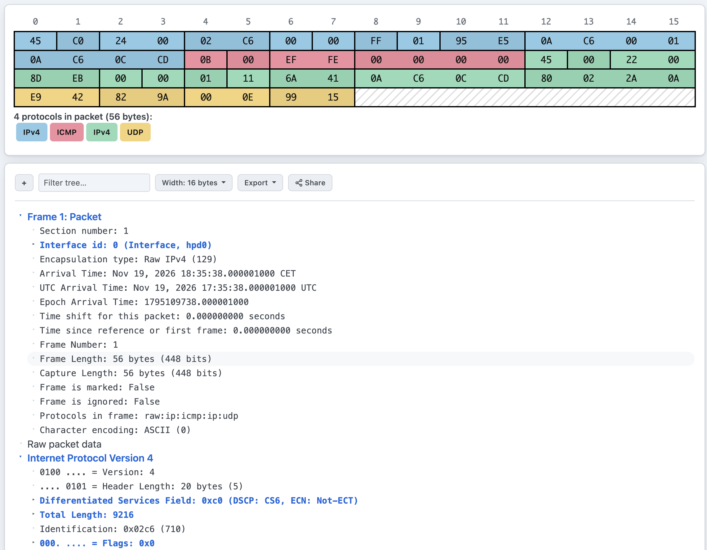
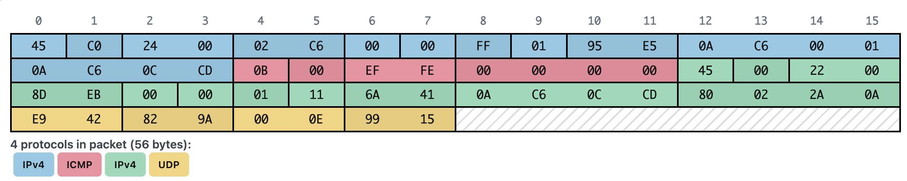
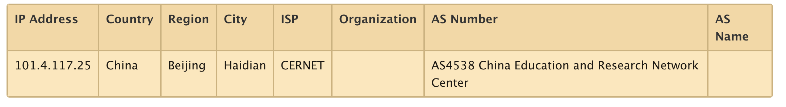
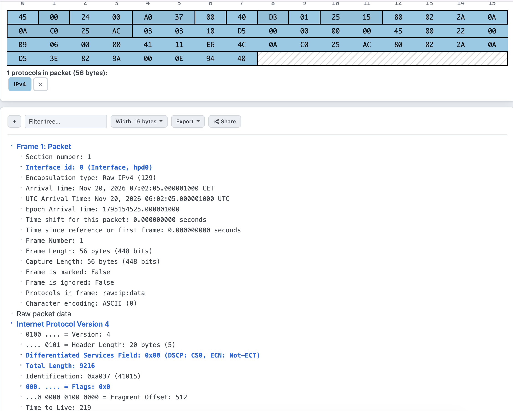
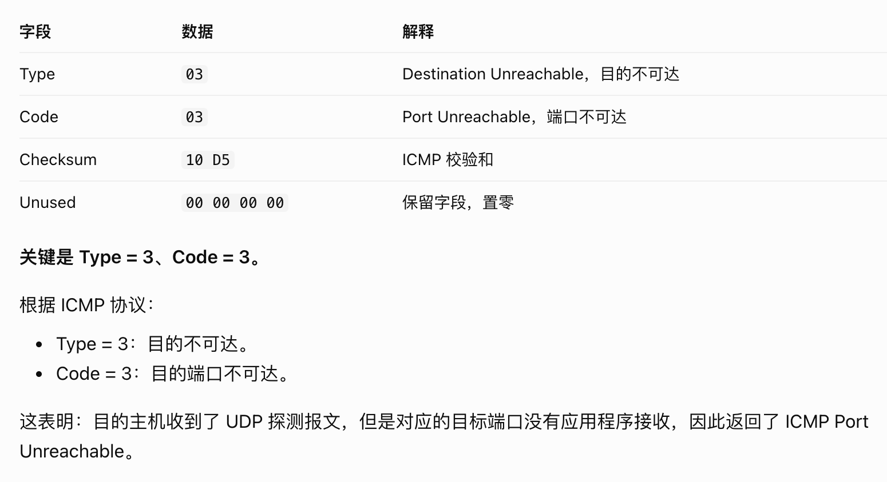
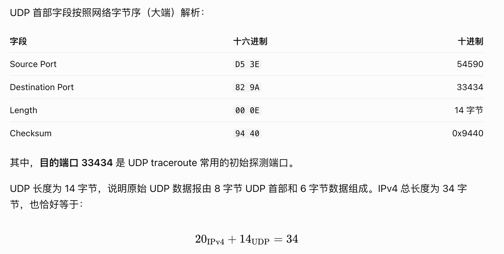

# CS168 Traceroute Project

See https://cs168.io/proj1/ for the spec.

# 个人笔记记录

## 第一阶段：手动运行路由追踪

```python
def traceroute(sendsock: util.Socket, recvsock: util.Socket, ip: str) \
        -> list[list[str]]:
    sendsock.set_ttl(1)
    sendsock.sendto("Potato".encode(), (ip, TRACEROUTE_PORT_NUMBER))
    if recvsock.recv_select():
        buf, address = recvsock.recvfrom()
        print("address:", address, "hex:", buf.hex())
    return []
```

console 返回:
```zsh
❯ python3 traceroute.py cmu.edu
traceroute to cmu.edu (128.2.42.10)
address: ('10.198.0.1', 0) hex: 45c0240002c60000ff0195e50ac600010ac60ccd0b00effe00000000450022008deb000001116a410ac60ccd80022a0ae942829a000e9915
```

在线解析网址: https://hpd.gasmi.net/

解析结果:
https://hpd.gasmi.net/?data=45C0240002C60000FF0195E50AC600010AC60CCD0B00EFFE00000000450022008DEB000001116A410AC60CCD80022A0AE942829A000E9915&force=ipv4




### 回答问题

1. 回复数据包是谁发送的？是cmu.edu，还是某个中间路由器？
先看 Internet Protocol Version 4 字段下的: Source, Destination:
```zsh
Source Address: 10.198.0.1
Destination Address: 10.198.12.205
```
10.198.0.1 是私有网段地址, 而cmu的ip地址应为: 128.2.42.10

再看 Internet Control Message Protocol 下的 Type 和 Code:
```zsh
Type: Time-to-live exceeded (11)
Code: 0 (Time to live exceeded in transit)
```
表明此报文是转发过程中 TTL 耗尽时返回的内容, 是由某个中间路由器发送的


2. 你发现中间路由器了吗？如果发现了，它的 IP 地址是什么？你是如何从数据包头部得知这个 IP 地址的？
根据 q1 中提到的 Source Address, 可以知道: 中间路由器的 ip 地址是: 10.198.0.1


对应于数据包头部的 第 12-15 位, 图中解码器直接显示了对应内容

3. 中间路由器想告诉你什么？它是在报告错误吗？如果是，你怎么知道它想表达什么？
见 q1 提到的 Internet Control Message Protocol 内容

中间路由器是在转发异常/错误: TTL 在到达目的地之前减为了0, 无法向前转发, 所以丢弃并传回通知. 同时Code为0表明超时报错.

4. 这个数据包中都包含哪些不同的头部信息？它们在这里有什么作用？


这张图把 56 个字节按 **每行 16 字节（列号 0～15）** 排列，并用颜色标出了 **4 个协议段**（共 56 字节）：

* **蓝色（20 字节，偏移 0～19）**：外层 **IPv4** 头（路由器发回 ICMP 报错包时自己加的头）


* **粉色（8 字节，偏移 20～27）**：**ICMP** 头（报错类型与子码）


* **绿色（20 字节，偏移 28～47）**：内层 **IPv4** 头（路由器附带的“原始触发包”的 IP 头）


* **黄色（8 字节，偏移 48～55）**：内层 **UDP** 头（“原始触发包”的 UDP 头）


---

#### 为什么这里有两段 IPv4？分别是什么？

根据 RFC 792 规范，当路由器丢弃一个因 **TTL 超时（Time Exceeded）** 而无法转发的数据包时，它会构造一个新的 **ICMP 错误报文** 发回给源主机，并在 ICMP 载荷里**附带原数据包的 IPv4 头 + 传输层头的前 8 字节（这里是 UDP 头）**。

* **第一段 IPv4（蓝色，偏移 0～19）—— 外层封装头**：它是中间路由器（`10.198.0.1`）**发往**你本机/当前网络侧（`10.198.12.205`）的这个 ICMP 报文的信封，告诉网络怎么把这个报错包送回给你。


* **第二段 IPv4（绿色，偏移 28～47）—— 内层证据/上下文头**：它是**你当初发出的那个 UDP 探测包**的 IPv4 头（目的地址 `128.2.42.10`，即 `cmu.edu`）。路由器把它塞进 ICMP 报错里，是为了让你知道“到底是发往哪个目的地的哪个包触发了 TTL 超时”。


---

#### 每段协议内如何划分？

下面按字节偏移（0-indexed，即整包第 0 字节到第 55 字节）逐段拆解：

##### 1. 外层 IPv4 头（蓝色：字节 0～19，共 20 字节）


* **字节 0（`45`）**：高 4 位 `4` = IPv4 版本；低 4 位 `5` = IHL（头部长度，5 × 4 = 20 字节）
* **字节 1（`C0`）**：DSCP / ECN（服务类型字段，值 `0xc0`）
* **字节 2～3（`24 00`）**：Total Length（总长度字段，十六进制 `0x2400` = 十进制 `9216`；注意前面抓包截图显示包长实际为 56 字节，这里头字段数值偏异常见于特定网络环境）


* **字节 4～5（`02 C6`）**：Identification（标识字段，`0x02c6` = `710`）


* **字节 6～7（`00 00`）**：Flags（标志位）与 Fragment Offset（片偏移），均为 `0`，表示未分片


* **字节 8（`FF`）**：TTL（生存时间，十六进制 `0xff` = 十进制 `255`）


* **字节 9（`01`）**：Protocol（上层协议号，`0x01` = 十进制 `1`，代表 **ICMP**）


* **字节 10～11（`95 E5`）**：Header Checksum（外层 IP 头部校验和，`0x95e5`）


* **字节 12～15（`0A C6 00 01`）**：Source Address（源 IP）：`0x0a.0xc6.0x00.0x01` = **`10.198.0.1`**（中间路由器）


* **字节 16～19（`0A C6 0C CD`）**：Destination Address（目的 IP）：`0x0a.0xc6.0x0c.0xcd` = **`10.198.12.205`**（接收方地址）


##### 2. ICMP 头（粉色：字节 20～27，共 8 字节）


* **字节 20（`0B`）**：Type（消息类型，`0x0b` = 十进制 **`11`**，即 **Time Exceeded**）


* **字节 21（`00`）**：Code（子代码，`0x00` = 十进制 **`0`**，即 **Time to live exceeded in transit**，传输途中 TTL 耗尽）


* **字节 22～23（`EF FE`）**：Checksum（ICMP 校验和，`0xeffe`）


* **字节 24～27（`00 00 00 00`）**：Unused（未使用/保留字段，全为 `0`）


##### 3. 内层 IPv4 头（绿色：字节 28～47，共 20 字节）


它对应的是你当初发送的 UDP 探测包的 IP 头：

* **字节 28（`45`）**：Version = 4，IHL = 5（20 字节）
* **字节 29（`00`）**：DSCP / ECN = `0x00`
* **字节 30～31（`22 00`）**：Total Length（`0x2200` / 字节序视实现而定）
* **字节 32～33（`8D EB`）**：Identification（`0x8deb`）
* **字节 34～35（`00 00`）**：Flags & Fragment Offset = `0`
* **字节 36（`01`）**：TTL = `0x01`（十进制 **`1`**，正是 TTL 减到 0 触发超时的原因）
* **字节 37（`11`）**：Protocol = `0x11`（十进制 **`17`**，代表 **UDP**）
* **字节 38～39（`6A 41`）**：Header Checksum（`0x6a41`）
* **字节 40～43（`0A C6 0C CD`）**：Source Address = **`10.198.12.205`**
* **字节 44～47（`80 02 2A 0A`）**：Destination Address：`0x80.0x02.0x2a.0x0a` = **`128.2.42.10`**（`cmu.edu`）

##### 4. 内层 UDP 头（黄色：字节 48～55，共 8 字节）


标准 UDP 头部固定 8 字节，每 2 字节（16 位）一个字段：

* **字节 48～49（`E9 42`）**：Source Port（源端口），`0xe942` = 十进制 **`59714`**
* **字节 50～51（`82 9A`）**：Destination Port（目的端口），`0x829a` = 十进制 **`33434`**（即 `TRACEROUTE_PORT_NUMBER`）
* **字节 52～53（`00 0E`）**：Length（UDP 报文总长度，含 8 字节头 + 载荷），`0x000e` = 十进制 **`14`** 字节（8 字节头 + 6 字节 `"Potato"`）
* **字节 54～55（`99 15`）**：Checksum（UDP 校验和），`0x9915`


### 更改不同TTL进行测试

#### TTL = 10

```zsh
❯ python3 traceroute.py cmu.edu
traceroute to cmu.edu (128.2.42.10)
address: ('101.4.117.25', 0) hex: 45c0240000850000f601b8f6650475190ac025ac0b0008d80000000045002200755d0000011169f60ac025ac80022a0af524829a000e745a
```
此时获得的ip, 在 网站: https://www.showmyip.com/bulk-ip-lookup/ 查询时, 得到的是:



#### TTL = 100

```zsh
❯ python3 traceroute.py cmu.edu
traceroute to cmu.edu (128.2.42.10)
address: ('128.2.42.10', 0) hex: 45002400a0370040db01251580022a0a0ac025ac030310d50000000045002200b90600004111e64c0ac025ac80022a0ad53e829a000e9440
```

此时解码后, 只含一个 IPv4 字段:



此时获得的 Destination Address, 查询后得到: 


正确抵达了 CMU 的服务器.

**注意, 上面的解码实际上是有问题的**. 因为 Router 可能采用 大端序和小端序 两种方式填写IPv4字段, 而这个解码网站固定解析大端序内容.
> CS168中, 我们约定使用大端序

此处的字节需要被按照小端序解码. 解码后, 应为同样的 IPv4 + ICMP + IPv4 + UDP:
1. 外层 IPv4 首部, 前20字节. 
```text
45 00 24 00 A0 37 00 40 DB 01 25 15
80 02 2A 0A 0A C0 25 AC
```


2. ICMP 首部, 接下来的 8 字节
```text
03 03 10 D5 00 00 00 00
```


3. 原始 IPv4 探测报文
```text
45 00 22 00 B9 06 00 00 41 11 E6 4C
0A C0 25 AC 80 02 2A 0A
```
类比于外层IPv4解析即可

4. 原始 UDP 首部
```text
D5 3E 82 9A 00 0E 94 40
```



