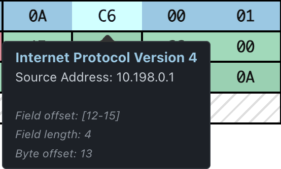
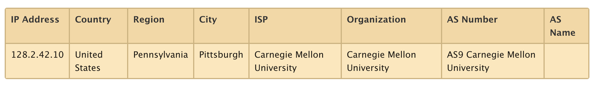
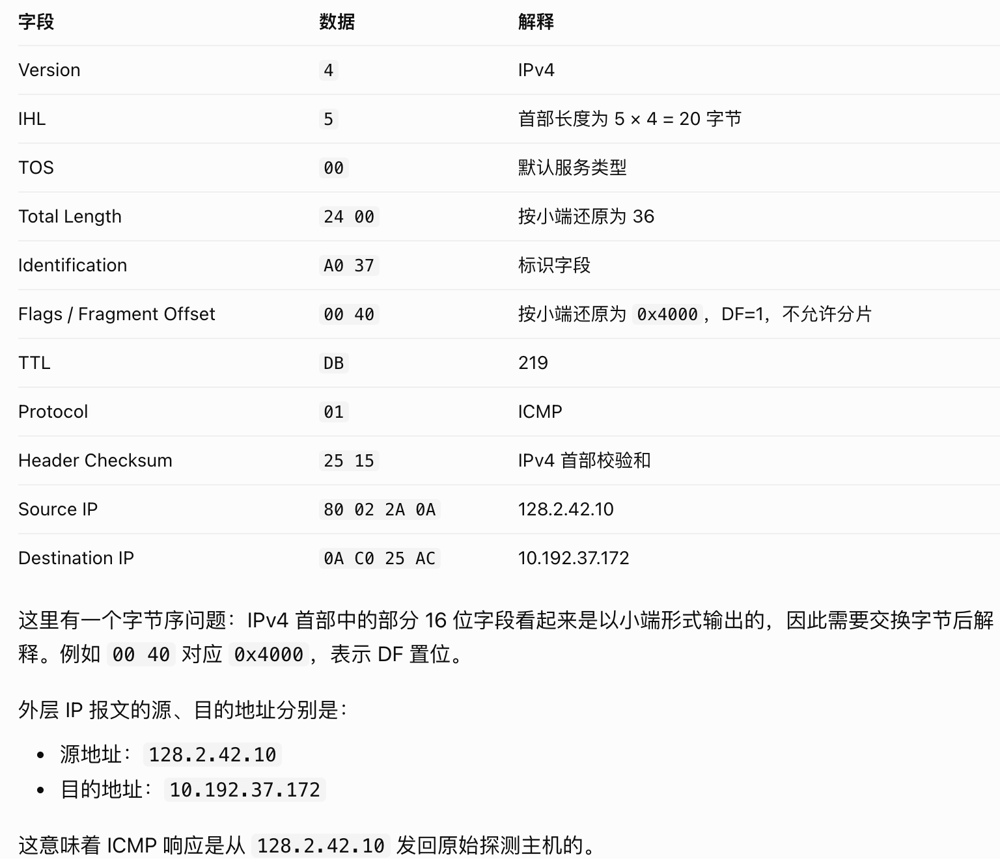

# CS168 Traceroute Project

See https://cs168.io/proj1/ for the spec.

# 个人笔记记录

## 第一阶段：手动运行路由追踪

```python
def traceroute(sendsock: util.Socket, recvsock: util.Socket, ip: str) \
        -> list[list[str]]:
    sendsock.set_ttl(1)
    sendsock.sendto("Potato".encode(), (ip, TRACEROUTE_PORT_NUMBER))
    if recvsock.recv_select():
        buf, address = recvsock.recvfrom()
        print("address:", address, "hex:", buf.hex())
    return []
```

console 返回:
```zsh
❯ python3 traceroute.py cmu.edu
traceroute to cmu.edu (128.2.42.10)
address: ('10.198.0.1', 0) hex: 45c0240002c60000ff0195e50ac600010ac60ccd0b00effe00000000450022008deb000001116a410ac60ccd80022a0ae942829a000e9915
```

在线解析网址: https://hpd.gasmi.net/

解析结果:
https://hpd.gasmi.net/?data=45C0240002C60000FF0195E50AC600010AC60CCD0B00EFFE00000000450022008DEB000001116A410AC60CCD80022A0AE942829A000E9915&force=ipv4


### 回答问题

1. 回复数据包是谁发送的？是cmu.edu，还是某个中间路由器？
先看 Internet Protocol Version 4 字段下的: Source, Destination:
```zsh
Source Address: 10.198.0.1
Destination Address: 10.198.12.205
```
10.198.0.1 是私有网段地址, 而cmu的ip地址应为: 128.2.42.10

再看 Internet Control Message Protocol 下的 Type 和 Code:
```zsh
Type: Time-to-live exceeded (11)
Code: 0 (Time to live exceeded in transit)
```
表明此报文是转发过程中 TTL 耗尽时返回的内容, 是由某个中间路由器发送的


2. 你发现中间路由器了吗？如果发现了，它的 IP 地址是什么？你是如何从数据包头部得知这个 IP 地址的？
根据 q1 中提到的 Source Address, 可以知道: 中间路由器的 ip 地址是: 10.198.0.1



对应于数据包头部的 第 12-15 位, 图中解码器直接显示了对应内容

3. 中间路由器想告诉你什么？它是在报告错误吗？如果是，你怎么知道它想表达什么？
见 q1 提到的 Internet Control Message Protocol 内容

中间路由器是在转发异常/错误: TTL 在到达目的地之前减为了0, 无法向前转发, 所以丢弃并传回通知. 同时Code为0表明超时报错.

4. 这个数据包中都包含哪些不同的头部信息？它们在这里有什么作用？


这张图把 56 个字节按 **每行 16 字节（列号 0～15）** 排列，并用颜色标出了 **4 个协议段**（共 56 字节）：

* **蓝色（20 字节，偏移 0～19）**：外层 **IPv4** 头（路由器发回 ICMP 报错包时自己加的头）


* **粉色（8 字节，偏移 20～27）**：**ICMP** 头（报错类型与子码）


* **绿色（20 字节，偏移 28～47）**：内层 **IPv4** 头（路由器附带的“原始触发包”的 IP 头）


* **黄色（8 字节，偏移 48～55）**：内层 **UDP** 头（“原始触发包”的 UDP 头）


---

#### 为什么这里有两段 IPv4？分别是什么？

根据 RFC 792 规范，当路由器丢弃一个因 **TTL 超时（Time Exceeded）** 而无法转发的数据包时，它会构造一个新的 **ICMP 错误报文** 发回给源主机，并在 ICMP 载荷里**附带原数据包的 IPv4 头 + 传输层头的前 8 字节（这里是 UDP 头）**。

* **第一段 IPv4（蓝色，偏移 0～19）—— 外层封装头**：它是中间路由器（`10.198.0.1`）**发往**你本机/当前网络侧（`10.198.12.205`）的这个 ICMP 报文的信封，告诉网络怎么把这个报错包送回给你。


* **第二段 IPv4（绿色，偏移 28～47）—— 内层证据/上下文头**：它是**你当初发出的那个 UDP 探测包**的 IPv4 头（目的地址 `128.2.42.10`，即 `cmu.edu`）。路由器把它塞进 ICMP 报错里，是为了让你知道“到底是发往哪个目的地的哪个包触发了 TTL 超时”。


---

#### 每段协议内如何划分？

下面按字节偏移（0-indexed，即整包第 0 字节到第 55 字节）逐段拆解：

##### 1. 外层 IPv4 头（蓝色：字节 0～19，共 20 字节）


* **字节 0（`45`）**：高 4 位 `4` = IPv4 版本；低 4 位 `5` = IHL（头部长度，5 × 4 = 20 字节）
* **字节 1（`C0`）**：DSCP / ECN（服务类型字段，值 `0xc0`）
* **字节 2～3（`24 00`）**：Total Length（总长度字段，十六进制 `0x2400` = 十进制 `9216`；注意前面抓包截图显示包长实际为 56 字节，这里头字段数值偏异常见于特定网络环境）


* **字节 4～5（`02 C6`）**：Identification（标识字段，`0x02c6` = `710`）


* **字节 6～7（`00 00`）**：Flags（标志位）与 Fragment Offset（片偏移），均为 `0`，表示未分片


* **字节 8（`FF`）**：TTL（生存时间，十六进制 `0xff` = 十进制 `255`）


* **字节 9（`01`）**：Protocol（上层协议号，`0x01` = 十进制 `1`，代表 **ICMP**）


* **字节 10～11（`95 E5`）**：Header Checksum（外层 IP 头部校验和，`0x95e5`）


* **字节 12～15（`0A C6 00 01`）**：Source Address（源 IP）：`0x0a.0xc6.0x00.0x01` = **`10.198.0.1`**（中间路由器）


* **字节 16～19（`0A C6 0C CD`）**：Destination Address（目的 IP）：`0x0a.0xc6.0x0c.0xcd` = **`10.198.12.205`**（接收方地址）


##### 2. ICMP 头（粉色：字节 20～27，共 8 字节）


* **字节 20（`0B`）**：Type（消息类型，`0x0b` = 十进制 **`11`**，即 **Time Exceeded**）


* **字节 21（`00`）**：Code（子代码，`0x00` = 十进制 **`0`**，即 **Time to live exceeded in transit**，传输途中 TTL 耗尽）


* **字节 22～23（`EF FE`）**：Checksum（ICMP 校验和，`0xeffe`）


* **字节 24～27（`00 00 00 00`）**：Unused（未使用/保留字段，全为 `0`）


##### 3. 内层 IPv4 头（绿色：字节 28～47，共 20 字节）


它对应的是你当初发送的 UDP 探测包的 IP 头：

* **字节 28（`45`）**：Version = 4，IHL = 5（20 字节）
* **字节 29（`00`）**：DSCP / ECN = `0x00`
* **字节 30～31（`22 00`）**：Total Length（`0x2200` / 字节序视实现而定）
* **字节 32～33（`8D EB`）**：Identification（`0x8deb`）
* **字节 34～35（`00 00`）**：Flags & Fragment Offset = `0`
* **字节 36（`01`）**：TTL = `0x01`（十进制 **`1`**，正是 TTL 减到 0 触发超时的原因）
* **字节 37（`11`）**：Protocol = `0x11`（十进制 **`17`**，代表 **UDP**）
* **字节 38～39（`6A 41`）**：Header Checksum（`0x6a41`）
* **字节 40～43（`0A C6 0C CD`）**：Source Address = **`10.198.12.205`**
* **字节 44～47（`80 02 2A 0A`）**：Destination Address：`0x80.0x02.0x2a.0x0a` = **`128.2.42.10`**（`cmu.edu`）

##### 4. 内层 UDP 头（黄色：字节 48～55，共 8 字节）


标准 UDP 头部固定 8 字节，每 2 字节（16 位）一个字段：

* **字节 48～49（`E9 42`）**：Source Port（源端口），`0xe942` = 十进制 **`59714`**
* **字节 50～51（`82 9A`）**：Destination Port（目的端口），`0x829a` = 十进制 **`33434`**（即 `TRACEROUTE_PORT_NUMBER`）
* **字节 52～53（`00 0E`）**：Length（UDP 报文总长度，含 8 字节头 + 载荷），`0x000e` = 十进制 **`14`** 字节（8 字节头 + 6 字节 `"Potato"`）
* **字节 54～55（`99 15`）**：Checksum（UDP 校验和），`0x9915`


### 更改不同TTL进行测试

#### TTL = 10

```zsh
❯ python3 traceroute.py cmu.edu
traceroute to cmu.edu (128.2.42.10)
address: ('101.4.117.25', 0) hex: 45c0240000850000f601b8f6650475190ac025ac0b0008d80000000045002200755d0000011169f60ac025ac80022a0af524829a000e745a
```
此时获得的ip, 在 网站: https://www.showmyip.com/bulk-ip-lookup/ 查询时, 得到的是:


#### TTL = 100

```zsh
❯ python3 traceroute.py cmu.edu
traceroute to cmu.edu (128.2.42.10)
address: ('128.2.42.10', 0) hex: 45002400a0370040db01251580022a0a0ac025ac030310d50000000045002200b90600004111e64c0ac025ac80022a0ad53e829a000e9440
```

此时解码后, 只含一个 IPv4 字段:


此时获得的 Destination Address, 查询后得到: 



正确抵达了 CMU 的服务器.

**注意, 上面的解码实际上是有问题的**. 因为 Router 可能采用 大端序和小端序 两种方式填写IPv4字段, 而这个解码网站固定解析大端序内容.
> CS168中, 我们约定使用大端序

此处的字节需要被按照小端序解码. 解码后, 应为同样的 IPv4 + ICMP + IPv4 + UDP:
1. 外层 IPv4 首部, 前20字节. 
```text
45 00 24 00 A0 37 00 40 DB 01 25 15
80 02 2A 0A 0A C0 25 AC
```


2. ICMP 首部, 接下来的 8 字节
```text
03 03 10 D5 00 00 00 00
```


3. 原始 IPv4 探测报文
```text
45 00 22 00 B9 06 00 00 41 11 E6 4C
0A C0 25 AC 80 02 2A 0A
```
类比于外层IPv4解析即可

4. 原始 UDP 首部
```text
D5 3E 82 9A 00 0E 94 40
```


### 1A 路由追踪处理

代码已实现. 详情见注释. 运行codes时, 请关闭TUN或虚拟网卡.

实现代码(1A):
```python
def traceroute(sendsock: util.Socket, recvsock: util.Socket, ip: str) \
        -> list[list[str]]:

    result = []
    reached = False

    for ttl in range(1, TRACEROUTE_MAX_TTL + 1):
        routers_this_ttl = []

        # 多次尝试
        for _ in range(PROBE_ATTEMPT_COUNT):
            #   send
            sendsock.set_ttl(ttl)
            sendsock.sendto("Potato".encode(), (ip, TRACEROUTE_PORT_NUMBER))

            # 判断有无返回信号
            if not recvsock.recv_select():
                continue

            # 得到对应返回的字节串
            buf, _ = recvsock.recvfrom()

            # 长度不足IPv4首部最短长度, 可能是截断包或异常短包，直接 IPv4(buf) 会越报错，直接丢弃并继续下一轮尝试。
            if len(buf) < 20:
                continue

            # 得到外部 IPv4 字段
            outer_ip = IPv4(buf)
            icmp_offset = outer_ip.header_len       # icmp 偏移量, 对应于IPv4header长度

            # 外层 IPv4 的上层协议不是 ICMP（协议号不为 1），
            # 或者剩余字节数不足以容纳一个完整的 8 字节 ICMP 首部 + 20 字节 内部IPv4 协议
            if outer_ip.proto != 1 or len(buf) < icmp_offset + 8 + 20:
                continue

            icmp = ICMP(buf[icmp_offset:])

            inner_ip_offset = icmp_offset + 8       # 固定长度, icmp偏移量 + 8
            inner_ip = IPv4(buf[inner_ip_offset:])

            inner_udp_offset = inner_ip_offset + inner_ip.header_len

            # 检查协议, 以及字节串长度, 协议为 17 代表内嵌协议为UDP
            if inner_ip.proto != 17 or len(buf) < inner_ip_offset + 8:
                continue

            inner_udp = UDP(buf[inner_udp_offset:])

            # 确认这条 ICMP 报错是由我们发往目标 IP / 探测端口的 UDP 包触发的
            if inner_ip.dst != ip or inner_udp.dst_port != TRACEROUTE_PORT_NUMBER:
                continue

            # Type 11 (Time Exceeded) 表示途经路由器；Type 3, Code 3 (Port Unreachable) 表示到达目标主机
            # 这是 UDP 常用的判定组合, 其余type不是 traceroute 探测期待的响应
            if icmp.type == 11 and icmp.code == 0:
                if outer_ip.src not in routers_this_ttl:
                    routers_this_ttl.append(outer_ip.src)
            elif icmp.type == 3 and icmp.code == 3:
                if outer_ip.src not in routers_this_ttl:
                    routers_this_ttl.append(outer_ip.src)
                reached = True

        util.print_result(routers_this_ttl, ttl)
        result.append(routers_this_ttl)

        if reached:
            break
    return result
```

本项目下的运行结果:
```zsh
❯ python3 traceroute.py cmu.edu
traceroute to cmu.edu (128.2.42.10)
 1: 10.192.0.1
 2: 10.255.255.26
 3: 202.119.26.82
 4: 10.99.0.29
 5: *
 6: 219.219.155.37
 7: 219.219.156.58
 8: 101.4.116.98
 9: 101.4.118.106
10: 101.4.117.25
11: 100.64.61.1
12: 101.4.112.61
13: 101.4.118.213
14: 101.4.112.65
15: 101.4.117.82
16: 210.25.189.237
17: 210.25.187.50
18: 202.179.241.9
19: 202.179.241.2
20: 202.179.241.102
21: *
22: *
23: 202.179.249.110
24: 202.179.249.110
25: fourhundredge-0-0-0-17.4079.core1.seat.net.internet2.edu (163.253.2.52)
26: fourhundredge-0-0-0-17.4079.core1.seat.net.internet2.edu (163.253.2.52)
27: fourhundredge-0-0-0-0.4079.core1.salt.net.internet2.edu (163.253.1.156)
28: fourhundredge-0-0-0-0.4079.core1.salt.net.internet2.edu (163.253.1.156)
29: fourhundredge-0-0-0-0.4079.core1.denv.net.internet2.edu (163.253.1.170)
    fourhundredge-0-0-0-0.4079.core1.kans.net.internet2.edu (163.253.1.243)
30: fourhundredge-0-0-0-0.4079.core1.kans.net.internet2.edu (163.253.1.243)
    fourhundredge-0-0-0-0.4079.core1.denv.net.internet2.edu (163.253.1.170)
```


真实世界运行结果:
```zsh
traceroute to cmu.edu (128.2.42.10), 64 hops max, 40 byte packets
 1  10.192.0.1 (10.192.0.1)  6.101 ms  4.644 ms  4.443 ms
 2  10.255.255.26 (10.255.255.26)  12.335 ms  8.183 ms  15.437 ms
 3  202.119.26.82 (202.119.26.82)  4.410 ms  4.340 ms  3.101 ms
 4  10.99.0.29 (10.99.0.29)  5.621 ms  6.395 ms  4.278 ms
 5  * * *
 6  219.219.155.29 (219.219.155.29)  6.084 ms
    219.219.155.37 (219.219.155.37)  13.088 ms
    219.219.155.29 (219.219.155.29)  7.975 ms
 7  219.219.156.118 (219.219.156.118)  24.752 ms
    219.219.156.58 (219.219.156.58)  6.938 ms
    219.219.156.54 (219.219.156.54)  6.893 ms
 8  101.4.116.98 (101.4.116.98)  6.643 ms  5.344 ms  5.609 ms
 9  101.4.118.106 (101.4.118.106)  4.280 ms  5.382 ms  7.644 ms
10  101.4.117.25 (101.4.117.25)  7.530 ms  8.378 ms  12.713 ms
11  100.64.61.1 (100.64.61.1)  9.768 ms  9.215 ms  10.834 ms
12  101.4.112.61 (101.4.112.61)  15.270 ms  16.818 ms  31.557 ms
13  101.4.118.213 (101.4.118.213)  16.829 ms  16.458 ms  16.470 ms
14  101.4.112.65 (101.4.112.65)  37.509 ms  32.849 ms  43.153 ms
15  * * *
16  210.25.189.237 (210.25.189.237)  39.798 ms  40.856 ms  42.044 ms
17  210.25.187.50 (210.25.187.50)  36.424 ms
    210.25.187.54 (210.25.187.54)  36.403 ms
    210.25.187.50 (210.25.187.50)  33.889 ms
18  202.179.241.9 (202.179.241.9)  32.904 ms  31.989 ms  32.976 ms
19  202.179.241.2 (202.179.241.2)  69.644 ms  69.370 ms  68.914 ms
20  202.179.241.102 (202.179.241.102)  102.461 ms  103.148 ms  104.050 ms
21  202.179.249.110 (202.179.249.110)  322.859 ms  314.443 ms  305.196 ms
22  fourhundredge-0-0-0-17.4079.core1.seat.net.internet2.edu (163.253.2.52)  370.314 ms
    fourhundredge-0-0-0-18.4079.core1.seat.net.internet2.edu (163.253.2.50)  364.602 ms
    fourhundredge-0-0-0-16.4079.core1.seat.net.internet2.edu (163.253.2.54)  396.911 ms
23  * fourhundredge-0-0-0-0.4079.core1.salt.net.internet2.edu (163.253.1.156)  426.040 ms  364.494 ms
24  fourhundredge-0-0-0-0.4079.core1.denv.net.internet2.edu (163.253.1.170)  371.381 ms  356.967 ms  361.870 ms
25  fourhundredge-0-0-0-0.4079.core1.kans.net.internet2.edu (163.253.1.243)  371.065 ms  350.905 ms  359.368 ms
26  fourhundredge-0-0-0-3.4079.core2.chic.net.internet2.edu (163.253.1.244)  367.127 ms  475.720 ms  349.432 ms
27  fourhundredge-0-0-0-22.4079.core1.chic.net.internet2.edu (163.253.1.96)  368.647 ms  343.538 ms
    fourhundredge-0-0-0-23.4079.core1.chic.net.internet2.edu (163.253.1.98)  323.722 ms
28  fourhundredge-0-0-0-12.4079.core1.eqch.net.internet2.edu (163.253.2.73)  371.464 ms  355.672 ms  371.008 ms
29  fourhundredge-0-0-0-0.4079.core1.clev.net.internet2.edu (163.253.1.210)  361.790 ms  374.612 ms  355.812 ms
30  fourhundredge-0-0-0-1.4079.core1.pitt.net.internet2.edu (163.253.1.189)  375.754 ms  367.642 ms  369.386 ms
31  internet2-pitt-rebr-jrt-mi-et-0-0-1-1011.3rox.net (192.88.115.82)  364.890 ms  360.983 ms  375.024 ms
32  rtr-acm.cmu.3rox.net (147.73.16.120)  359.807 ms  359.989 ms  357.258 ms
33  border-fw-inet.gw.cmu.net (192.12.32.20)  369.525 ms * *
34  core1-border-fw.gw.cmu.net (128.2.5.67)  371.023 ms
    core2-border-fw.gw.cmu.net (128.2.5.68)  359.476 ms
    core1-border-fw.gw.cmu.net (128.2.5.67)  324.785 ms
35  pod-d-dcns-9500-core2.gw.cmu.net (128.2.255.15)  339.231 ms
    pod-d-cyh-9500-core2.gw.cmu.net (128.2.255.13)  370.577 ms
    pod-d-dcns-9500-core1.gw.cmu.net (128.2.0.15)  374.406 ms
36  cmu-vip.andrew.cmu.edu (128.2.42.10)  371.707 ms  377.203 ms  376.708 ms
```